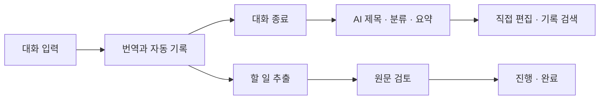

<div align="center">

# SpeechBridge

**대화를 번역하고, 기록을 요약하고, 필요한 일을 이어가는 앱.**

Android · iOS · Kotlin Multiplatform · Mac Local AI

[시작하기](#시작하기) · [주요 기능](#주요-기능) · [구현 상태](#구현-상태) · [문서](docs/README.md) · [이슈](https://github.com/slfkalstks/SpeechBridge/issues)

</div>

---

SpeechBridge는 일상과 업무에서 나눈 대화를 번역·기록하고, 요약과 할 일로 연결하는 모바일 앱입니다. Android와 iOS가 같은 Compose UI와 데이터 규칙을 공유하며, AI 추론은 휴대전화 대신 Mac의 로컬 모델에서 처리합니다.

> **현재는 개발 중인 시제품입니다.** 음성 중심의 화면은 준비되어 있지만 앱의 실제 마이크 입력·자동 언어 감지·음성 재생은 아직 연결하지 않았습니다. 지금은 보조 키보드로 텍스트 흐름을 사용할 수 있습니다. 일반 사용자용 서버 연결·인증과 스토어 배포도 준비 전입니다.

## 주요 기능

- **한국어·영어·일본어 번역** — 입력 언어와 번역 언어를 각각 선택하고, 가운데 아이콘으로 즉시 맞바꿉니다.
- **자동 기록** — 추가한 문장은 기기에 저장됩니다. 언어를 바꿔도 작성 중인 텍스트는 유지합니다.
- **대화 요약** — 종료 시 AI가 제목·분류·요약을 한 번 작성합니다. 이후에는 직접 편집합니다.
- **일상과 업무 분류** — 업무 유형과 사용자 지정 폴더를 함께 사용해 기록·할 일을 찾습니다.
- **근거가 있는 할 일** — 원문에서 요청과 결정을 추출하고, 근거를 검토한 뒤 진행·완료 상태를 관리합니다.
- **내용 수정과 검색** — 원문·정리 항목을 수정하고 기록과 할 일을 검색합니다. 원문이 바뀌면 관련 항목을 다시 검토합니다.
- **라이트·다크 모드** — 설정의 아이콘으로 기기 설정 → 라이트 → 다크를 전환합니다. 선택은 앱을 다시 열어도 유지됩니다.

화자를 설정하거나 누가 말했는지 판단하는 기능은 제공하지 않습니다. 기록은 확정된 텍스트이며, 원음 녹음 파일을 저장한다는 의미는 아닙니다.

## 화면과 사용 흐름

| 화면 | 할 수 있는 일 |
| --- | --- |
| 대화 | 언어 선택·교환, 음성 준비 안내, 보조 키보드 입력, 원문과 번역 확인 |
| 기록 | 날짜별 목록, 검색, 일상·업무·폴더 필터, 제목·분류·요약 직접 수정 |
| 할 일 | 원문 근거 확인, 담당자·기한 편집, 검토·진행·완료 관리 |
| 설정 | 아이콘으로 화면 모드 전환, 업무 폴더 관리, 로컬 저장 상태 확인 |



AI 결과는 검토 가능한 초안입니다. 제안과 확정된 결정을 구분하도록 설계했지만, 결과의 정확성을 보장하지는 않습니다. 제목·분류·요약을 만들지 못해도 원문 기록은 남으며 직접 편집할 수 있습니다.

## 구현 상태

| 영역 | 상태 |
| --- | --- |
| Android / iOS 공통 UI, 기기 저장, 검색·분류·할 일 | 구현 |
| 텍스트 번역, AI 제목·분류·요약, 할 일 추출 | Mac 로컬 서버 연결 구현 |
| 마이크 중심 UI | 구현 — 실제 청취 대신 준비 안내 |
| STT / TTS 서버 엔진 | 별도 샘플 검증 이력 있음; 모바일 앱 연결 보류 |
| 실제 마이크, 자동 언어 감지, 실기기 음성 검증 | 보류 |
| 일반 사용자용 자동 서버 연결·인증·스토어 배포 | 준비 전 |

개발용 연결 설정은 **Debug 빌드의 설정 → 더보기 → 개발자 연결 설정**에만 있습니다. 배포판은 사용자에게 Mac 주소나 개발 토큰을 요구하지 않습니다. 현재 Release 빌드의 AI 요청은 서비스 준비 안내를 반환하며, 로컬 기록 기능은 사용할 수 있습니다.

## 기술 구성

| 계층 | 사용 기술 |
| --- | --- |
| 공통 앱 | Kotlin Multiplatform, Compose Multiplatform, Material 3 |
| 상태·네트워크 | Coroutines, StateFlow, Ktor, Kotlin Serialization |
| 플랫폼 | Android 앱 / iOS SwiftUI 진입점 + Compose UI |
| 저장 | 플랫폼별 앱 전용 파일 저장소, JSON, 원자적 파일 교체 |
| API | Node.js 22+, 취소·타임아웃·입력 검증·추론 대기열 |
| 번역 모델 | TranslateGemma 12B |
| 요약·분류·추출 모델 | Gemma 4 12B IT QAT |
| 추론 | Mac의 Ollama 로컬 런타임 |

유료 API와 자동 과금 fallback은 사용하지 않습니다. 모델은 휴대전화에 설치하지 않습니다. 의존성 버전은 [`gradle/libs.versions.toml`](gradle/libs.versions.toml), 모델 설정은 [`server/setup-local.mjs`](server/setup-local.mjs)가 기준입니다.

## 시작하기

### 1. 저장소 받기

```sh
git clone https://github.com/slfkalstks/SpeechBridge.git
cd SpeechBridge
```

Android Studio에서 **`settings.gradle.kts`가 있는 이 폴더**를 여세요. 상위 폴더를 열면 Gradle 프로젝트를 찾지 못할 수 있습니다.

### 2. 앱 실행

프로젝트 설정은 Android 최소 API 35, compile/target SDK 37, iOS 18.2 이상입니다. 검증에는 macOS, JDK 25, Android SDK, Xcode의 iOS 시뮬레이터를 사용했습니다. Gradle은 저장소의 wrapper를 사용합니다.

**Android**

```sh
./gradlew :androidApp:assembleDebug
```

Android Studio에서 `androidApp`을 에뮬레이터에 실행하거나 생성된 Debug APK를 설치합니다.

**iOS — macOS / Xcode 필요**

`iosApp/iosApp.xcodeproj`를 열고 `iosApp` scheme과 iOS 시뮬레이터를 선택해 실행합니다.

서버 없이도 키보드 입력, 기록, 검색, 수동 편집을 확인할 수 있습니다. 번역과 AI 정리는 아래 로컬 서버가 필요합니다.

### 3. Mac 로컬 AI 실행 — 개발용

Node.js 22+와 Ollama를 준비합니다. 모델 다운로드에는 별도 저장 공간이 필요합니다. 기존 검증 환경에서는 두 기본 모델의 다운로드 합계가 약 15.3GB였으며, 실행 메모리 요구량과는 다릅니다.

첫 번째 터미널:

```sh
cd server
npm run start:ai
```

두 번째 터미널에서 모델을 한 번 내려받습니다.

```sh
OLLAMA_HOST=127.0.0.1:11435 ollama pull translategemma:12b
OLLAMA_HOST=127.0.0.1:11435 ollama pull gemma4:12b-it-qat
```

저장소 루트의 세 번째 터미널:

```sh
cd server
npm run setup:local
npm run start:local
```

`setup:local`은 `.runtime/server.env`에 개발용 토큰을 만들며 기존 파일은 보존합니다. Debug 앱의 **설정 → 더보기 → 개발자 연결 설정**에서 로컬 주소와 이 토큰을 사용합니다. 토큰 파일은 Git에 포함하지 않습니다.

- iOS 시뮬레이터: `http://localhost:8787`
- Android 에뮬레이터: `http://10.0.2.2:8787` 또는 `adb reverse tcp:8787 tcp:8787` 후 `http://localhost:8787`
- 실제 휴대전화 연결은 아직 검증하지 않았습니다.

서버의 상세 계약과 음성 엔진 준비 과정은 [API 설정 문서](docs/API_SETUP.md)를 참고하세요. 일반 사용자는 이 개발 절차를 수행하는 대상이 아닙니다.

## 테스트

```sh
# Android 공통 테스트와 앱 빌드
./gradlew :shared:testAndroidHostTest :androidApp:assembleDebug

# iOS 공통 테스트 — macOS / Xcode 필요
./gradlew :shared:iosSimulatorArm64Test

# API 회귀 테스트 — 별도 모델 없이 실행
npm --prefix server test

# 디자인 색상 일치와 텍스트 대비 검사
python3 scripts/check-design.py
```

실제 모델을 실행한 가상 대화 평가는 `node server/evaluate-summary.mjs`로 수행합니다. 작은 합성 평가 결과를 실제 음성 성능이나 일반적인 정확도로 해석하지 않습니다. 최신 검사 범위는 [검증 기록](docs/LANGUAGE_SETTINGS_VALIDATION.md)에 남깁니다.

## 프로젝트 구조

```text
SpeechBridge/
├── androidApp/       # Android 진입점과 리소스
├── iosApp/           # Xcode 프로젝트와 iOS 진입점
├── shared/src/
│   ├── commonMain/   # UI, 도메인, 상태, API, 저장 규칙
│   ├── commonTest/   # 공통 회귀 테스트
│   ├── androidMain/  # Android 저장·플랫폼 코드
│   └── iosMain/      # iOS 저장·플랫폼 코드
├── server/           # 무료 로컬 AI API와 평가 스크립트
├── docs/             # 제품 계약, 실행 절차, 조사·검증 기록
├── plans/            # 구현 계획과 진행 이력
└── scripts/          # 디자인 검증 도구
```

## 로드맵

- [ ] 모바일 마이크 입력과 STT/TTS 연결
- [ ] 대화 언어 자동 감지
- [ ] 실제 휴대전화 연결·저장·음성 성능 검증
- [ ] 일반 사용자용 서비스 주소 배포와 사용자별 인증
- [ ] 서버 운영·오프라인 대응·스토어 배포 준비
- [ ] VoiceOver / TalkBack 실사용 검증 확대

## 기여

버그나 개선 제안은 [Issues](https://github.com/slfkalstks/SpeechBridge/issues)에 남겨 주세요. 재현 순서, 플랫폼, 기대 동작과 실제 동작을 함께 적으면 도움이 됩니다. PR에는 변경 목적과 실행한 검사를 기록해 주세요.

개인 대화, 접속 토큰, `.runtime`의 모델과 실행 환경, 빌드 산출물은 커밋하지 않습니다. 실제 마이크 구현 여부와 검증 범위를 구분하고, 유료 서비스로 자동 전환하는 코드는 추가하지 않습니다.

## 디자인 참고

[Apple Design Skill](https://github.com/dickwu/apple-design-skill), [MaterialYouNewTab](https://github.com/prem-k-r/MaterialYouNewTab), [Impeccable](https://github.com/pbakaus/impeccable), [Taste Skill](https://github.com/Leonxlnx/taste-skill)의 디자인 원칙과 사례를 참고했습니다. 외부 프로젝트의 앱이나 스킬 전체를 이 저장소에 재배포하지 않습니다.

## 라이선스

프로젝트 코드의 라이선스는 아직 지정하지 않았습니다. 사용 모델과 외부 의존성에는 각각의 라이선스가 적용됩니다.
