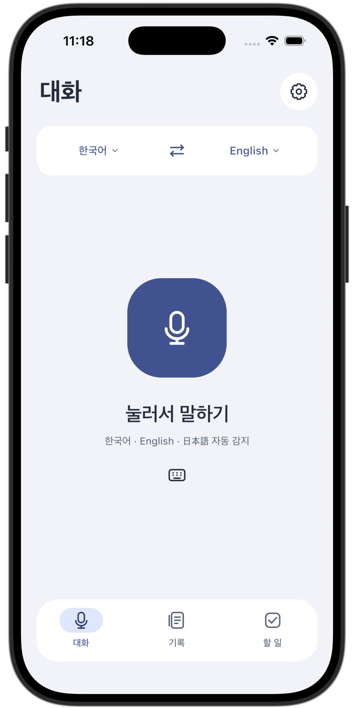
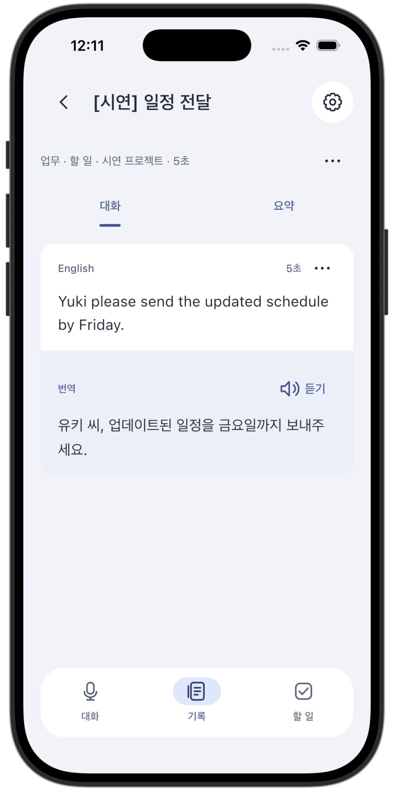
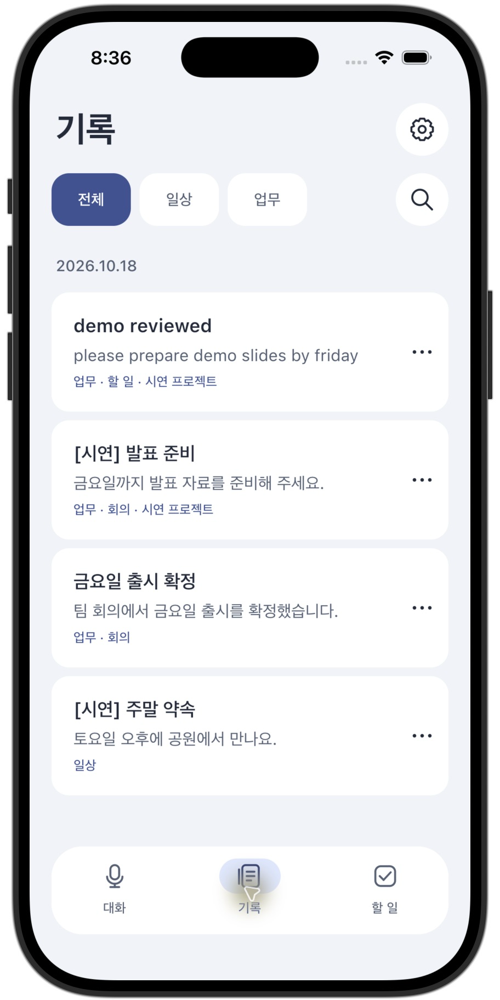
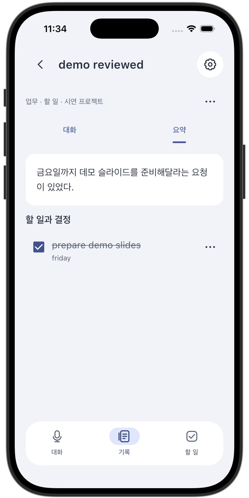
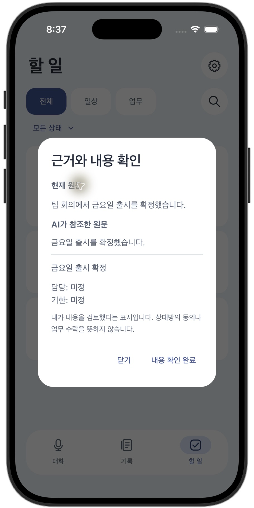
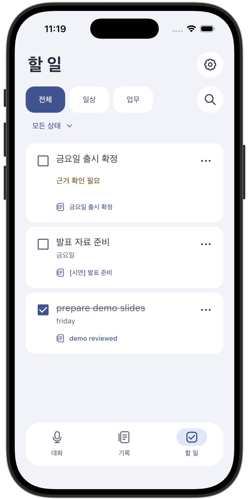
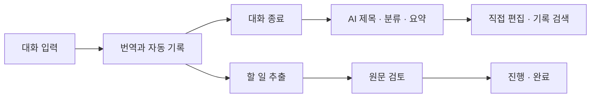

<div align="center">

# SpeechBridge

**대화를 번역하고, 기록을 요약하고, 필요한 일을 이어가는 앱.**

Android · iOS · Kotlin Multiplatform · Mac Local AI

[발표 PPTX](presentation/SpeechBridge.pptx) · [시작하기](#시작하기) · [시연 안내](docs/DEMO.md) · [주요 기능](#주요-기능) · [구현 상태](#구현-상태) · [문서](docs/README.md) · [이슈](https://github.com/slfkalstks/SpeechBridge/issues)

</div>

---

SpeechBridge는 일상과 업무에서 나눈 대화를 번역·기록하고, 요약과 할 일로 연결하는 모바일 앱입니다. Android와 iOS가 같은 Compose UI와 데이터 규칙을 공유하며, AI 추론은 휴대전화 대신 Mac의 로컬 모델에서 처리합니다.

> **학교 과제용 시제품입니다.** 회원 인증·PostgreSQL 저장·로컬 AI·음성 입력/재생을 구현했고, 앱 직접 시연과 자동 회귀를 수행했습니다. 실기기·마이크·청취 검증은 보류 중입니다. 공개 운영 도메인과 스토어 서명은 아직 없으며, 출시 완료를 의미하지 않습니다. [최신 검증과 남은 항목](docs/PRE_RELEASE.md).

## 실제 앱 화면

발표 PPTX에 사용한 **실제 iOS 시뮬레이터 캡처**입니다. 가상 시연 데이터를 사용했으며, 번역 화면은 보조 키보드 입력으로 검증했습니다.

<table>
  <tr><th>대화</th><th>번역</th><th>기록</th></tr>
  <tr>
    <td></td>
    <td></td>
    <td></td>
  </tr>
  <tr><th>요약</th><th>근거 확인</th><th>할 일</th></tr>
  <tr>
    <td></td>
    <td></td>
    <td></td>
  </tr>
</table>

## 발표 자료

**[편집 가능한 PPTX 다운로드](presentation/SpeechBridge.pptx)** · [PDF 미리보기](presentation/SpeechBridge.pdf) · [발표자 노트](presentation/발표자-노트.md)

7장, 약 5–7분 구성입니다. 핵심 기능·실제 앱 화면·AI 모델별 역할·간단한 서버 구조·라이브 시연을 담았습니다. 텍스트와 도형은 편집할 수 있고 캡처 이미지는 교체할 수 있습니다. [제작·재생성 안내](presentation/README.md).

## 주요 기능

- **음성 입력·재생** — 마이크를 눌러 말하고 완료하면 언어를 자동 감지해 기록·번역합니다. 한 번에 최대 30초이며, 새 번역은 자동으로 읽고, 설정에서 끌 수 있습니다. 수동 듣기·준비 중·중지 버튼도 제공합니다.
- **한국어·영어·일본어 번역** — 입력 언어와 번역 언어를 각각 선택하고, 가운데 아이콘으로 즉시 맞바꿉니다.
- **자동 기록** — 추가한 문장과 초안은 계정별 PostgreSQL에 저장됩니다. 연결이 끊기면 전송 대기 내용만 기기에 암호화해 보관합니다. 언어를 바꿔도 작성 중인 텍스트는 유지합니다.
- **대화 요약** — 종료 시 AI가 제목·분류·요약을 한 번 작성합니다. DB에 접수된 작업은 앱 종료·서버 재시작 후에도 이어지며, 이후에는 직접 편집합니다.
- **일상과 업무 분류** — 업무 유형과 사용자 지정 폴더를 함께 사용해 기록·할 일을 찾습니다.
- **근거가 있는 할 일** — 원문에서 요청과 결정을 추출하고, 근거를 검토한 뒤 진행·완료 상태를 관리합니다.
- **내용 수정과 검색** — 원문·정리 항목을 수정하고 기록과 할 일을 검색합니다. 원문이 바뀌면 관련 항목을 다시 검토합니다.
- **회원 인증** — 회원가입·로그인 후 내 기록과 AI 기능을 사용합니다. 로그인 정보는 플랫폼 보안 저장소에 보관합니다.
- **화면 모드** — 기기 설정·라이트·다크 아이콘을 가로로 나열해 바로 선택합니다. 선택은 앱을 다시 열어도 유지됩니다.

화자를 설정하거나 누가 말했는지 판단하는 기능은 제공하지 않습니다. 기록은 확정된 텍스트이며, 원음 녹음 파일을 저장한다는 의미는 아닙니다.

## 화면과 사용 흐름

| 화면 | 할 수 있는 일 |
| --- | --- |
| 대화 | 언어 선택·교환, 음성 입력·자동 감지·번역 읽기, 보조 키보드, 원문과 번역 확인 |
| 기록 | 날짜별 목록, 검색, 일상·업무·폴더 필터, 제목·분류·요약 직접 수정 |
| 할 일 | 원문 근거 확인, 담당자·기한 편집, 검토·진행·완료 관리 |
| 설정 | 회원가입·로그인, 가로 아이콘으로 화면 모드 선택, 번역 자동 읽기 켜기/끄기, 업무 폴더 관리, 서버 저장 상태·기존 기록 가져오기·충돌 보관 |



AI 결과는 검토 가능한 초안입니다. 제안과 확정된 결정을 구분하도록 설계했지만, 결과의 정확성을 보장하지는 않습니다. 제목·분류·요약을 만들지 못해도 원문 기록은 남으며 직접 편집할 수 있습니다.

## 구현 상태

| 영역 | 상태 |
| --- | --- |
| Android / iOS 공통 UI, 계정별 DB 저장, 검색·분류·할 일 | 구현 |
| 텍스트 번역, AI 제목·분류·요약, 할 일 추출 | Mac 로컬 서버 연결 구현 |
| Android / iOS 녹음·재생과 음성 UI | 구현·빌드 검증, 시스템 권한 요청 확인 |
| STT / TTS 서버 엔진·회원 인증·자동 언어 감지 | 3언어 합성 샘플 API 검증 |
| 같은 Wi-Fi의 Debug 앱 HTTPS 연결 | 구현·iOS 시뮬레이터 확인, Android APK 준비 |
| 실제 휴대전화 녹음·청취·소음 환경 검증 | 미검증 — 설치·테스트 절차 제공 |
| 회원가입·로그인·세션 복원, 빌드에 지정한 주소 자동 연결 | 구현 — 게스트 없음 |
| 앱·웹 계정 삭제, 백업 보존·검증 복원·전환 | 구현·회귀 검증 |
| Android Release AAB / iOS 기기용 Release archive | 빌드 검증; 테스트 주소·미서명, 제출용 아님 |
| 외부 HTTPS 주소·스토어 배포 | 운영 주소·배포자 정보·서명 필요 |

배포판은 빌드에 지정한 HTTPS 주소를 자동 사용하며, 사용자에게 Mac 주소나 공용 토큰을 요구하지 않습니다. 주소가 없는 Release 빌드는 실패하도록 차단합니다. Debug 시뮬레이터는 Mac으로 자동 접속합니다. 자세한 실행·보안·한계는 [회원 서버 안내](docs/ACCOUNT_SERVER.md)를 참고하세요.

기록은 로그인한 계정의 PostgreSQL을 원본으로 사용합니다. 로그아웃하면 화면에서 기록을 숨기며, 미전송 내용은 같은 계정으로 다시 로그인했을 때 이어서 전송합니다. 기존 기기 기록은 설정에서 명시적으로 가져온 뒤 서버 사본을 검증하고 기기 원본을 비웁니다.

## 기술 구성

| 계층 | 사용 기술 |
| --- | --- |
| 공통 앱 | Kotlin Multiplatform, Compose Multiplatform, Material 3 |
| 상태·네트워크 | Coroutines, StateFlow, Ktor, Kotlin Serialization |
| 플랫폼 | Android 앱 / iOS SwiftUI 진입점 + Compose UI |
| 저장 | PostgreSQL, 사용자별 RLS·트랜잭션·version, 암호화 전송 대기함 |
| API·인증 | Node.js 22.16 이상~26 미만, PostgreSQL, scrypt, 만료·폐기 가능한 개인 세션 |
| 로그인 보관 | Android Keystore AES-GCM / iOS Keychain |
| 번역 모델 | TranslateGemma 12B |
| 요약·분류·추출 모델 | Gemma 4 12B IT QAT |
| 음성 인식 | Nemotron 3.5 ASR Streaming 0.6B Q8 / NeMo-Speech.cpp Metal |
| 음성 합성 | Qwen3-TTS-12Hz-0.6B-CustomVoice / MLX bf16 |
| 추론 | Mac의 Ollama·Metal·MLX 로컬 런타임 |

유료 API와 자동 과금 fallback은 사용하지 않습니다. 모델은 휴대전화에 설치하지 않습니다. 의존성 버전은 [`gradle/libs.versions.toml`](gradle/libs.versions.toml), 모델 설정은 [`server/setup-local.mjs`](server/setup-local.mjs)가 기준입니다.

발표자료에는 AI 모델의 이름과 역할만 담았습니다. [비교를 포함한 상세 선정 근거](docs/MODEL_SELECTION.md)는 개발 문서에 별도로 보관합니다. 번역 12B는 비교한 4B의 의미 변형 사례를 고려해 유지했고, 정리용 Gemma는 소수 영·일 추출 비교에서 빠른 응답을 확인했습니다. 음성 모델은 세 언어와 Mac 실행 가능성을 확인한 기준선입니다.

최근에는 **모델을 바꾸지 않고 재로딩을 줄였습니다.** 요약 모델 사용 뒤 번역 3회 평균은 4.42→1.98초(55.3% 감소), 이미 준비된 번역 100회 평균은 1.66→1.67초로 차이가 없었습니다. 첫 전환 재로딩은 여전히 가능하며 상주 메모리를 더 사용합니다. [측정 방법·전체 수치·원자료](docs/TRANSLATION_PERFORMANCE.md).

## 시작하기

이미 실행 환경을 준비한 현재 Mac에서는 `./Demo.command`로 서버를 확인하고 iPhone 시뮬레이터 앱을 시작할 수 있습니다. 별도 시연 계정·예시 기록·Android APK·5분 진행 순서는 [시연 안내](docs/DEMO.md)를 참고하세요. 처음 받은 저장소에는 로컬 모델·인증서·설치 파일이 포함되지 않으므로 아래 환경 준비가 먼저 필요합니다.

### 1. 저장소 받기

```sh
git clone https://github.com/slfkalstks/SpeechBridge.git
cd SpeechBridge
```

Android Studio에서 **`settings.gradle.kts`가 있는 이 폴더**를 여세요. 상위 폴더를 열면 Gradle 프로젝트를 찾지 못할 수 있습니다.

### 2. 앱 실행

프로젝트 설정은 Android 최소 API 35, compile/target SDK 37, iOS 18.2 이상입니다. 검증에는 macOS, JDK 25, Android SDK, Xcode의 iOS 시뮬레이터를 사용했습니다. Gradle은 저장소의 wrapper를 사용합니다.

**Android**

```sh
./gradlew :androidApp:assembleDebug
```

Android Studio에서 `androidApp`을 에뮬레이터에 실행하거나 생성된 Debug APK를 설치합니다.

**iOS — macOS / Xcode 필요**

`iosApp/iosApp.xcodeproj`를 열고 `iosApp` scheme과 iOS 시뮬레이터를 선택해 실행합니다.

첫 로그인과 서버 기록 조회에는 아래 PostgreSQL·회원 API가 필요합니다. 로그인 후 연결이 끊겨도 현재 작업의 변경 내용은 암호화 대기함에 보관하고 연결 복구 시 다시 전송합니다.

### 3. Mac 로컬 AI 실행 — 개발용

Node.js 22.16 이상~26 미만과 Ollama를 준비합니다. 모델 다운로드에는 별도 저장 공간이 필요합니다. 기존 검증 환경에서는 두 기본 모델의 다운로드 합계가 약 15.3GB였으며, 실행 메모리 요구량과는 다릅니다.

첫 번째 터미널:

```sh
cd server
npm run start:ai
```

두 번째 터미널에서 모델을 한 번 내려받습니다.

```sh
OLLAMA_HOST=127.0.0.1:11435 ollama pull translategemma:12b
OLLAMA_HOST=127.0.0.1:11435 ollama pull gemma4:12b-it-qat
```

저장소 루트의 세 번째 터미널:

```sh
npm --prefix server ci --ignore-scripts --cache .runtime/npm-cache
npm --prefix server run db:install
npm --prefix server run db:init
npm --prefix server run setup:accounts
npm --prefix server run start:accounts
```

`setup:accounts`는 `.runtime/accounts-server.env`를 만들며 기존 파일을 보존합니다. 계정과 사용자 데이터의 PostgreSQL도 `.runtime/postgres`에만 설치합니다. 기존 SQLite 계정 이전은 [DB 안내](docs/POSTGRES.md)를 따릅니다. Debug 앱은 iOS 시뮬레이터에서 `http://localhost:8787`, Android 에뮬레이터에서 `http://10.0.2.2:8787`로 자동 접속합니다. **시작 화면 → 로그인 / 회원가입**에서 사용할 계정을 만드세요. 공용 토큰 입력은 필요 없습니다.

실제 휴대전화에는 Mac에 연결되는 HTTPS 주소를 빌드에 지정해야 합니다. 현재 도메인과 외부 운영 주소는 없습니다. 시뮬레이터 시연은 Wi-Fi에 의존하지 않는 loopback HTTPS를 사용하며, 휴대전화 테스트 때는 LAN 주소로 다시 준비·빌드합니다. [회원 서버·배포 주소 설정](docs/ACCOUNT_SERVER.md)을 참고하세요. 기존 공용 토큰을 사용하는 개발 도구와 음성 평가 경로는 별도로 유지합니다.

## 테스트

```sh
# Android 공통 테스트와 앱 빌드
./gradlew :shared:testAndroidHostTest :androidApp:assembleDebug

# iOS 공통 테스트 — macOS / Xcode 필요
./gradlew :shared:iosSimulatorArm64Test

# Android 에뮬레이터의 Keystore 포함 검증
./gradlew :shared:connectedAndroidDeviceTest

# API 회귀 테스트 — db:init 이후, 별도 모델 없이 실행
npm --prefix server test

# 디자인 색상 일치와 텍스트 대비 검사
python3 scripts/check-design.py
```

실제 모델을 실행한 가상 대화 평가는 `node server/evaluate-summary.mjs`로 수행합니다. 작은 합성 평가 결과를 실제 음성 성능이나 일반적인 정확도로 해석하지 않습니다. 음성 연결과 즉시 실행할 테스트는 [음성 테스트 안내](docs/NATIVE_VOICE_VALIDATION.md)를 참고하세요. 최신 중앙 저장 검증은 [모바일 DB 연결 검증](docs/CLOUD_WORKSPACE_VALIDATION.md)과 [TDD 기록](docs/POSTGRES_TDD.md)을 참고하세요.

## 프로젝트 구조

```text
SpeechBridge/
├── androidApp/       # Android 진입점과 리소스
├── iosApp/           # Xcode 프로젝트와 iOS 진입점
├── shared/src/
│   ├── commonMain/   # UI, 도메인, 상태, API, 저장 규칙
│   ├── commonTest/   # 공통 회귀 테스트
│   ├── androidMain/  # Android 저장·플랫폼 코드
│   └── iosMain/      # iOS 저장·플랫폼 코드
├── server/           # 무료 로컬 AI API와 평가 스크립트
├── docs/             # 제품 계약, 실행 절차, 조사·검증 기록
├── presentation/     # 편집 가능한 PPTX, PDF, 실제 앱 화면
├── plans/            # 구현 계획과 진행 이력
└── scripts/          # 디자인 검증 도구
```

## 로드맵

- [x] 모바일 마이크 입력과 STT/TTS 연결
- [x] 대화 언어 자동 감지
- [ ] 실제 휴대전화 연결·저장·음성 성능 검증
- [x] 회원가입·로그인·보안 저장 및 자동 서버 주소 적용
- [ ] 외부 HTTPS 고정 주소 운영
- [x] 서버 운영·오프라인 복구·계정 삭제·백업/복원 도구
- [x] Release 빌드 검사·발표 PPTX·실제 화면 문서
- [ ] 공개 배포용 도메인·개인정보 운영 정보·스토어 서명
- [ ] VoiceOver / TalkBack 실사용 검증 확대

## 기여

버그나 개선 제안은 [Issues](https://github.com/slfkalstks/SpeechBridge/issues)에 남겨 주세요. 재현 순서, 플랫폼, 기대 동작과 실제 동작을 함께 적으면 도움이 됩니다. PR에는 변경 목적과 실행한 검사를 기록해 주세요.

개인 대화, 접속 토큰, `.runtime`의 모델과 실행 환경, 빌드 산출물은 커밋하지 않습니다. 실제 마이크 구현 여부와 검증 범위를 구분하고, 유료 서비스로 자동 전환하는 코드는 추가하지 않습니다.

## 디자인 참고

[Apple Design Skill](https://github.com/dickwu/apple-design-skill), [MaterialYouNewTab](https://github.com/prem-k-r/MaterialYouNewTab), [Impeccable](https://github.com/pbakaus/impeccable), [Taste Skill](https://github.com/Leonxlnx/taste-skill)의 디자인 원칙과 사례를 참고했습니다. 외부 프로젝트의 앱이나 스킬 전체를 이 저장소에 재배포하지 않습니다.

## 라이선스

프로젝트 코드의 라이선스는 아직 지정하지 않았습니다. 사용 모델과 외부 의존성에는 각각의 라이선스가 적용됩니다.
