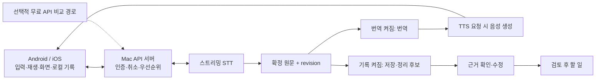

# SpeechBridge 무료 구현 방안 조사·선정

조사 기준일: **2026-10-17**. 조건: 수업 과제, KMP Android/iOS, 한국어·영어·일본어, 번역/기록 독립 사용, AI 계산은 서버, **유료 사용 금지**, 사용 가능한 서버 장비는 현재 **M3 Max 36GB Mac**뿐이다.

> 후속 구현 업데이트: 텍스트 로컬 provider와 모델 비교를 완료했다. 현재 실행법은 [API_SETUP](API_SETUP.md), 실측은 [LOCAL_AI_RESULTS](LOCAL_AI_RESULTS.md)를 따른다. 아래 조사는 후보 선정 시점의 근거다.

## 결정 요약

**현재 Mac의 공개 모델 서버를 기본 경로로 준비하고, 정식 무료 API를 동일 조건의 품질·지연 비교군으로 둔다.** UI/UX는 기존 ECC 스킬과 Compose로 만들고 별도 캔버스가 필요하면 Penpot Free를 사용한다. 이 구성은 추가 API 요금·GPU 임대료·디자인 구독료 없이 진행할 수 있는 출발점이다. 기존 장비의 전기·인터넷·운영 부담까지 없어지는 것은 아니다.

문서에서 확인되는 지원 언어·실제 스트리밍·Mac 가속·라이선스·무료 조건으로 후보를 추렸다. **조사 당시에는 모델을 실행하지 않았다. 후속 텍스트 실측도 “모든 후보 중 성능1위”나 “실시간 통역 달성”의 근거는 아니다.** 실측 없는 숫자로 가장 좋다고 단정하는 대신, 비교할 구체적 구성과 승자를 고르는 기준까지 정했다.

## 우선 검증 구성

| 기능 | 첫 후보 | 선택 근거와 주요 비교군 |
|---|---|---|
| STT | **Nemotron-3.5-ASR-Streaming-0.6B + NeMo-Speech.cpp Metal** | 세 언어·입력 스트리밍·Mac·WebSocket이 공식 확인됨. Q8 가중치 약742MB(실행 RAM 아님). Voxtral Realtime, Qwen3-ASR1.7B, Cohere Transcribe, Whisper large-v3/turbo 비교 |
| 번역 | **TranslateGemma12B 양자화** | 번역 전용·세 언어, Mac 실행 경로.4B와 품질/속도 비교하고27B는 품질 비교. 범용 LLM 하나로 번역+추출하는 구성도 비교 |
| 기록 정리 | **Gemma4 12B QAT** | 공식 양자화 배포·다국어·구조화 응답 경로. Qwen3.5-9B, Gemma4 26B-A4B, Qwen3.8-27B 비교. 내용을 근거에 연결하는 별도 검증 필수 |
| TTS | **Qwen3-TTS0.6B CustomVoice + MLX-Audio** | 세 언어·Apple Silicon 포트·PCM chunk 스트리밍.1.7B·VoxCPM2·Chatterbox 비교. Supertonic3은 작은 CPU 기준선이지만 공식 지원 종료 고려 |
| UI/UX | **ECC 설계 스킬 + Compose**, 필요 시 **Penpot Free/MCP** | 기존 KMP에서 직접 렌더링·사용성 확인, 별도 유료 디자인 서비스 불필요 |

공식 근거: [NVIDIA 모델](https://huggingface.co/nvidia/nemotron-3.5-asr-streaming-0.6b), [NVIDIA 런타임](https://github.com/NVIDIA/NeMo-Speech.cpp), [TranslateGemma](https://huggingface.co/google/translategemma-12b-it), [Gemma4 QAT](https://huggingface.co/google/gemma-4-12B-it-qat-q4_0-gguf), [Qwen TTS](https://github.com/QwenLM/Qwen3-TTS), [MLX 포트](https://github.com/Blaizzy/mlx-audio), [Penpot 무료 플랜](https://penpot.app/pricing).

이 표는 여러 모델을 동시에 최대 크기로 상주시키라는 의미가 아니다.36GB를 macOS·IDE·시뮬레이터와 공유한다. 우선 번역을 활성화하고 추출은 대화 종료 후 또는 낮은 우선순위로 실행한다. 자원 경쟁이 크면 번역4B 또는 번역/추출 통합 모델, CPU TTS, 무료 외부 API 조합을 비교한다. 선택 순서는 조사 범위 제한이 아니라 효율적인 검증 순서다.

## 왜 무료 API만으로 바로 확정하지 않는가

무료 API가 이 Mac보다 빠르거나 정확할 가능성은 있다. 실제 비교 전에 자체 서버가 항상 우월하다고 주장하지 않는다. 다만 무료량·계정 자격·네트워크·정책 변경에 의존하므로, 시연의 기본 경로와 비교 기준선을 분리하는 것이 현재 과제에 적합하다는 판단이다.

| 후보 | 공식 무료 조건 | 역할 |
|---|---|---|
| DeepL API Free | 월50만자, 현재 개발자 페이지 카드 불필요 명시 | 여섯 방향 텍스트 번역 우선 비교 |
| Azure Translator F0 | 월200만자; F0 한도 종료 오류 정의 | 번역 비교. 이전 Azure 사용안을 유료 S0/PAYG와 묶지 않음 |
| Azure Speech F0 | STT 월5시간, Neural TTS 월50만자 | 실시간 음성 비교. F0 전용 조건 확인 |
| Groq Free | 모델별 RPM/RPD/토큰·음성 한도, 계정 Limits 우선 | Whisper 파일 전사 및 LLM 추출 비교 |
| Gemini Developer API Free | 현재 텍스트·Transcribe/Live·TTS 무료 대상 존재; 모델별 계정 quota | 통합 무료 cloud 비교. 무료 데이터의 제품 개선 사용 조건 확인 |
| Mistral API Free / OpenRouter free / Workers AI Free | 각각 조직 quota / 무구매50회·일 /10,000neurons·일 | 추가 비교군. 상시 무제한이 아님 |

출처: [DeepL 플랜](https://support.deepl.com/hc/en-us/articles/360021200939-DeepL-API-plans), [DeepL 가입](https://www.deepl.com/en/developers), [Azure 번역](https://azure.microsoft.com/en-us/pricing/details/translator/), [Azure 음성](https://azure.microsoft.com/en-us/pricing/details/speech/), [Groq](https://console.groq.com/docs/rate-limits), [Gemini 가격](https://ai.google.dev/gemini-api/docs/pricing), [Gemini quota](https://ai.google.dev/gemini-api/docs/rate-limits), [Mistral](https://docs.mistral.ai/getting-started/quickstarts/studio/activate-and-generate-api-key), [OpenRouter](https://openrouter.ai/pricing), [Workers AI](https://developers.cloudflare.com/workers-ai/platform/pricing/).

프로젝트 정책: 무료 플랜/SKU 확인 후에만 연결하고, 한도 소진·429·장애 시 **유료 모델 자동 대체·유료 업그레이드·추가 credits 구매를 하지 않는다.** 초과 과금형 서비스의 예산 알림만으로 무과금 보장을 대체하지 않는다. 아직 사용자 계정의 무료 접근 여부나 quota를 확인하지 않았고 어떠한 API도 호출하지 않았다.

## 조사 중 발견한 중요한 차이

- **HY-MT1.5:** 작은 고성능 번역 후보지만 공식 가중치 라이선스 Territory가 대한민국을 제외한다. 현재 기본 선택에서 제외한다. [공식 License.txt](https://huggingface.co/tencent/HY-MT1.5-7B/blob/main/License.txt)
- **Supertonic3:** 가벼운 세 언어 TTS 후보지만 공식 저장소가 보관 처리되고 지원 종료를 명시한다. 사용 불가라는 뜻은 아니나 장기 유지보수 조건을 고려한다. [공식 저장소](https://github.com/supertone-oss-archive/supertonic)
- **Cerebras:** 옛 가격 페이지에 Free가 남아 있으나 현재 한도 문서는 결제수단 확인 후$5/30일 trial을 설명한다. 갱신되는 무료 API로 채택하지 않는다. [현재 문서](https://inference-docs.cerebras.ai/support/rate-limits)
- **GPU notebook/ZeroGPU:** 무료 실험 경로는 있으나 자원·시간·대기열 제한이 있다. 상시 무료 회의 서버와 동일하게 보지 않는다. [Colab](https://research.google.com/colaboratory/faq.html), [ZeroGPU](https://huggingface.co/docs/hub/spaces-zerogpu)
- **스트리밍:** 이미 완성된 파일을 토큰으로 흘려주는 API, 짧은 녹음을 반복 전사하는 방식, 실제 입력 스트리밍 모델은 구분해야 한다. 이 구분을 [STT 상세](research/STT.md)에 기록했다.
- **최신·큰 모델:** 새 모델이나 큰 모델이 이 Mac의 대화 지연과 한국어/일본어 중요 오류에서 자동으로 우세하지 않는다. 같은 시험의 실제 결과로 선택한다.

## 권고 구조 — 후속 구현안

번역/기록의 독립 설정을 유지한다. 빠른 경로는 STT→확정 번역→TTS이고, 요청 추출은 별도 작업이다. 부분 인식은 화면에 임시 표시하며 미확정 번역을 바로 음성으로 읽지 않는다. 수정·취소 후 도착한 이전 결과는 session/utterance/revision으로 버린다. 근거 없는 담당자·기한은 확정하지 않고, 원문 수정은 기존 항목을 재검토로 돌린다.

정확도를 높이려면 신뢰도 숫자 하나보다 원문 연결·수정 이력·수치/부정 확인·근거 검토가 중요하다. 필요할 때만 확정 STT를 다른 모델로 재검토하는 방식도 비교하되 사용자의 수정을 자동 덮어쓰지 않는다. 현재 다중 근거 인용·실제 음성 전송은 후속 설계/구현이며 이미 완성된 기능으로 표시하지 않는다.

## 실측으로 최상을 확정하는 절차

1. **텍스트부터 비교:** ko↔en, ko↔ja, en↔ja 여섯 방향. 여행·일상·업무의 숫자/시간/고유명사/부정/경어/정정 문장을 동일하게 입력한다. 추출은 요청·가정·취소·결정의 정답 근거를 따로 만든다.
2. **공개 음성 비교:** FLEURS 등 사용 가능한 공개 음성으로 STT 기준선과 무음·오검출을 검사한다. TTS는 원문과 생성음을 사람이 대조한다. 사용자의 실제 음성이나 실기기 없이 가능한 초기 단계이며 아직 실행하지 않았다.
3. **동시 실행:** STT+번역+TTS와 기록 추출을 동시에 동작시켜 p50/p95·메모리·swap·중단/재연결을 측정한다. 단일 모델의 최고 tokens/sec로 앱 성능을 대신하지 않는다.
4. **무료 API와 비교:** 계정 무료 조건이 확인된 경로만 같은 입력으로 측정한다. 실제 회의 자료를 보내기 전 데이터 이용 조건을 확인한다.
5. **선정:** 중요한 의미 오류·근거 없는 추출을 먼저 배제하고, 통과 후보 중 지연·실패율·운영 지속성이 좋은 구성을 고른다. 언어별 다른 모델 선택도 허용한다. 품질 우세가 없는 큰 모델은 기본값으로 두지 않는다.
6. **마지막에 실기기:** 사용자가 가능해지는 시점에 마이크·스피커 되먹임·대면 소음·네트워크·세 언어 실제 대화와 UX를 검증한다.

평가 데이터와 학습 데이터는 분리한다. 처음부터 학습할 필요는 없다. 공개 모델의 템플릿·용어집·스키마·자원 배치를 먼저 조정하고, 반복되는 도메인 오류와 검증된 데이터가 확보될 때만 LoRA를 별도 비교한다. 학습으로 좋아질 것이라는 가정으로 모델을 선정하지 않는다.

## 조사 범위·확신과 현재 구현

조사 범위는 공개 STT/TTS/번역/LLM, Mac 가속 실행기, 통합 음성 모델, OS 음성, 정식 무료 API, 체험 credits, 무료 notebook/CPU/GPU 호스팅, UI/UX 스킬·디자인 도구다. 특정 업체·모델 계열로 제한하지 않았지만 모든 인터넷 서비스를 빠짐없이 조사했다고 주장하지 않는다. 공개 문서로 답이 안 나오는 성능·계정 조건은 아래처럼 남겼다.

| 확신 | 내용 |
|---|---|
| 확인됨 | 실제 Mac 칩·메모리, 인용한 공식 문서의 기능/언어/현재 조건, 설치된 스킬 역할 |
| 설계 판단 | Mac 기본 경로·무료 cloud 비교·모델별 우선 검증 순서·실시간과 추출 분리 |
| 미확인 | 이 Mac의 실제 지연/정확도/동시 메모리, 사용자 계정 quota, 실기기 연결·음질, 실제 최상 조합 |

ECC `deep-research`의 조사·1차 출처 확인·비교·사실/판단 구분 절차를 사용했다. Exa/Firecrawl 도구가 제공되지 않아 내장 웹 검색과 공식 페이지 열람으로 대체했고 STT·TTS·텍스트를 병렬 조사했다. 실제 모델 측정이 없다는 결손은 문헌 추가 검색만으로 메울 수 없다.

**조사 완료 당시 이력(후속 로컬 연결 전):** 기존 Azure/OpenAI provider의 외부 호출을 제거했고 `.env.example`에서 공급자 키를 제거했다. 키를 넣어도 다시 활성화되지 않는 테스트를 포함해 당시 Node 서버7개 테스트가 통과했다. 현재18개 검증과 로컬 추론 결과는 VALIDATION/LOCAL_AI_RESULTS를 따른다. 무료 provider 연결 전 번역/AI정리는 준비 중 오류를 반환하며 결과를 꾸며내지 않는다. 직접 입력·기록 수정·근거 검토·수동 할 일 기능은 유지한다. 모델 다운로드·학습·API 호출·디자인 서비스 연결은 수행하지 않았다.

## 상세 근거

- [음성 인식 후보·무료 API·언어별 수치](research/STT.md)
- [번역·추출 모델·무료 조건·라이선스](research/TEXT.md)
- [음성 합성 후보·Mac 실행·스트리밍](research/TTS.md)
- [실행기·호스팅·네트워크·평가](research/INFRASTRUCTURE.md)
- [무료 UI/UX 도구·ECC 스킬](research/UI_UX.md)
- [현재 서버 연결 상태와 실행법](API_SETUP.md)

위 문서들은 조사/설계 기준이다. 실제 활성 provider와 검증 결과는 코드 및 [VALIDATION.md](VALIDATION.md)를 기준으로 한다.
