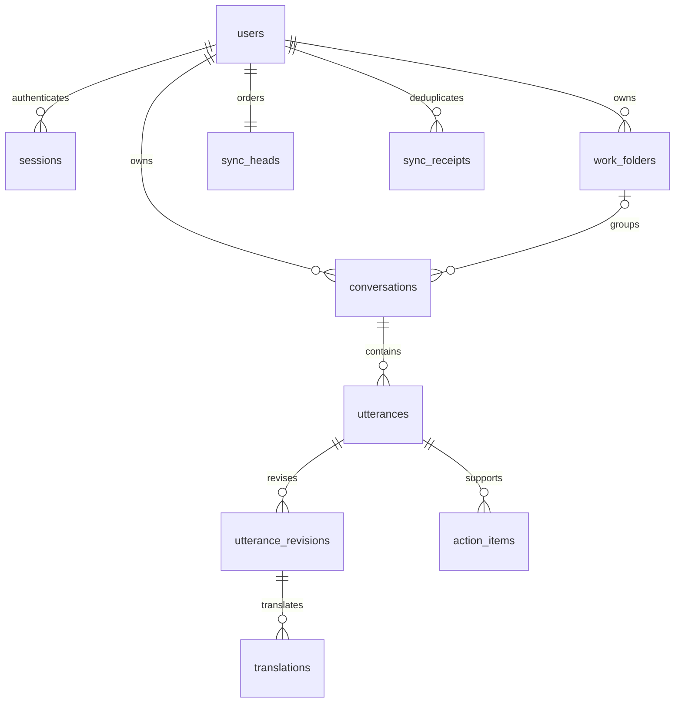

# 프로젝트 전용 PostgreSQL

2026-10-18 서버 구현 기준. 모바일 중앙 저장 연결은 [전체 진행표](../plans/postgres-voice-release.md)를 따른다.

## 실행

프로젝트 루트에서 실행한다. 전역 패키지·설정·다른 DB 서비스를 변경하지 않는다.

```sh
npm --prefix server ci --ignore-scripts --cache .runtime/npm-cache
npm --prefix server run db:install
npm --prefix server run db:init
npm --prefix server run db:import-accounts
npm --prefix server run start:accounts
```

설치 스크립트는 공식 PostgreSQL 18.6 소스와 고정 SHA-256을 사용한다. Xcode 명령줄 빌드 도구가 필요하다. 바이너리·소스·데이터·소켓·비밀번호·로그는 `.runtime/postgres/`에만 생성한다. UTF-8 builtin locale를 사용하고 ICU/readline 의존성은 제외한다. 기존 Homebrew·MariaDB·시스템 서비스는 수정하지 않는다.

`db:init`은 이 클러스터에 `speechbridge`, `speechbridge_test`를 만든다. PostgreSQL은 TCP를 열지 않고 프로젝트 Unix 소켓(권한 0700)만 사용한다. Node API만 DB에 연결한다. `.runtime/postgres/server.env`, `test.env`, `credentials.json`은 공개하지 않는다.

```sh
npm --prefix server run db:status
npm --prefix server run db:start
npm --prefix server run db:migrate
npm --prefix server run db:backup
npm --prefix server run db:stop
npm --prefix server run test:coverage
```

백업은 `.runtime/backups/`에 custom-format dump로 생성한다. 같은 Mac에 있는 백업은 Mac 자체 고장에 대한 복구 수단은 아니다. 마이그레이션 파일은 적용 후 수정하지 않고 새 번호를 추가한다. 체크섬 변경 시 적용을 거부한다.

## 역할

| 역할 | 접근 범위 |
|---|---|
| speechbridge_admin | 프로젝트 클러스터 초기화·마이그레이션·백업. API에서 사용하지 않음 |
| speechbridge_owner | 로그인 불가, 스키마 소유 |
| speechbridge_auth | 회원·해시 세션·이전 이력 |
| speechbridge_app | 사용자 데이터. 비소유자, superuser/BYPASSRLS 없음 |

복합 키와 외래 키에 `user_id`를 포함한다. RLS는 트랜잭션에만 설정한 인증 사용자 ID를 사용한다. 요청 본문의 사용자 ID로 소유권을 결정하지 않는다. 이는 API 검증을 보완하며 서버 관리자나 서버 전체 침해를 차단한다는 뜻은 아니다.

## 스키마

| 테이블 | 저장 내용 |
|---|---|
| users / sessions | 계정, scrypt hash/salt/파라미터, 해시 토큰·발급 순서·만료 |
| user_settings / devices | 화면 모드, 앱 설치 ID·플랫폼 |
| work_folders | 사용자 지정 업무 폴더·version·삭제 표시 |
| conversations | 제목·요약·언어·일상/업무·업무 유형·폴더·AI 최초 처리 상태·revision |
| utterances / utterance_revisions | 최초/현재 원문, 알려진 수정본·revision·순서 |
| translations | 원문 revision과 번역 대상 언어별 번역 |
| action_items | 발화 근거·내용·담당자/기한 텍스트·검토·완료·입력 순서 |
| conversation_drafts | 사용자+설치+초안 범위별 입력 내용과 언어 |
| ai_jobs | AI 작업·원문 revision·상태. 최초 organize 고유 제약. 실행 연결은 후속 단계 |
| sync_heads / sync_changes | 사용자별 커밋 순서·변경 엔티티·version·삭제 표시 |
| sync_receipts | 사용자+설치+요청 ID별 요청 해시·응답 |
| legacy_account_imports | 이미 이전한 계정 ID. 폐기된 세션의 재복원 방지 |
| schema_migrations | 버전·SQL 체크섬·적용 시각 |



정확한 타입·제약·인덱스는 [`server/db/migrations/`](../server/db/migrations/)가 기준이다. 시간은 timestamptz, 기존 ID는 text, revision은 integer, version/cursor는 bigint이다. API의 version/cursor는 JS 정수 손실을 피하도록 문자열이다. JSONB는 초안과 revision 맵 등 부가 정보에 사용한다.

기존 기록에 없는 중간 수정본 원문은 만들어 내지 않는다. 최초/현재 원문과 알려진 revision을 보존한다. `action_items.source_revision`은 이 때문에 수정본 테이블의 FK 대신 발화 FK와 입력 검증을 사용한다. legacy_speaker는 보존 필드이며 화자 판별 기능은 없다.

## 동기화 API

모든 경로에 개인 bearer 세션이 필요하다. 응답은 `Cache-Control: no-store`다.

- `POST /data/snapshot` `{deviceId}` → archive, 해당 설치의 drafts, versions, cursor
- `POST /data/mutate` `{deviceId,mutationId,entity,id,baseVersion,value}` → 저장. value=null이면 삭제. entity는 conversation/folder/settings/draft
- `POST /data/changes` `{after}` → 최대 500개 변경과 다음 cursor

사용자별 카운터 행을 잠근 뒤 변경·영수증·순서를 함께 커밋한다. 같은 요청 ID/내용은 같은 응답을 반환하며 내용이 바뀌면 `mutation_reused`(409)다. 오래된 version은 `version_conflict`(409), 삭제된 엔티티는 늦은 업로드로 복구되지 않는다. 폴더 삭제 시 관련 대화는 보존하고 폴더만 해제하며 version/변경 목록도 함께 갱신한다.

## 계정 이전

기존 API 쓰기를 중지한 상태에서 `db:import-accounts`를 실행한다. SQLite를 읽기 전용으로 열고 일관된 백업을 만든 뒤 그 백업을 가져온다. ID·비밀번호 hash/salt·유효 세션을 유지한다. 충돌하면 전체 트랜잭션을 취소한다. 원본을 삭제하지 않는다. 재실행해도 이미 이전한 계정의 세션을 다시 삽입하지 않는다.

회원 API는 PostgreSQL 설정이 없으면 시작하지 않는다. SQLite로 자동 복귀하지 않는다. 전환 이후의 새 데이터를 보존하지 않고 이전 DB 파일로 단순 복귀하지 않는다.

## 공식 근거

[18.6 소스](https://ftp.postgresql.org/pub/source/v18.6/), [빌드·설치](https://www.postgresql.org/docs/18/install-make.html), [행 보안](https://www.postgresql.org/docs/18/ddl-rowsecurity.html), [백업·복원](https://www.postgresql.org/docs/18/backup-dump.html).
