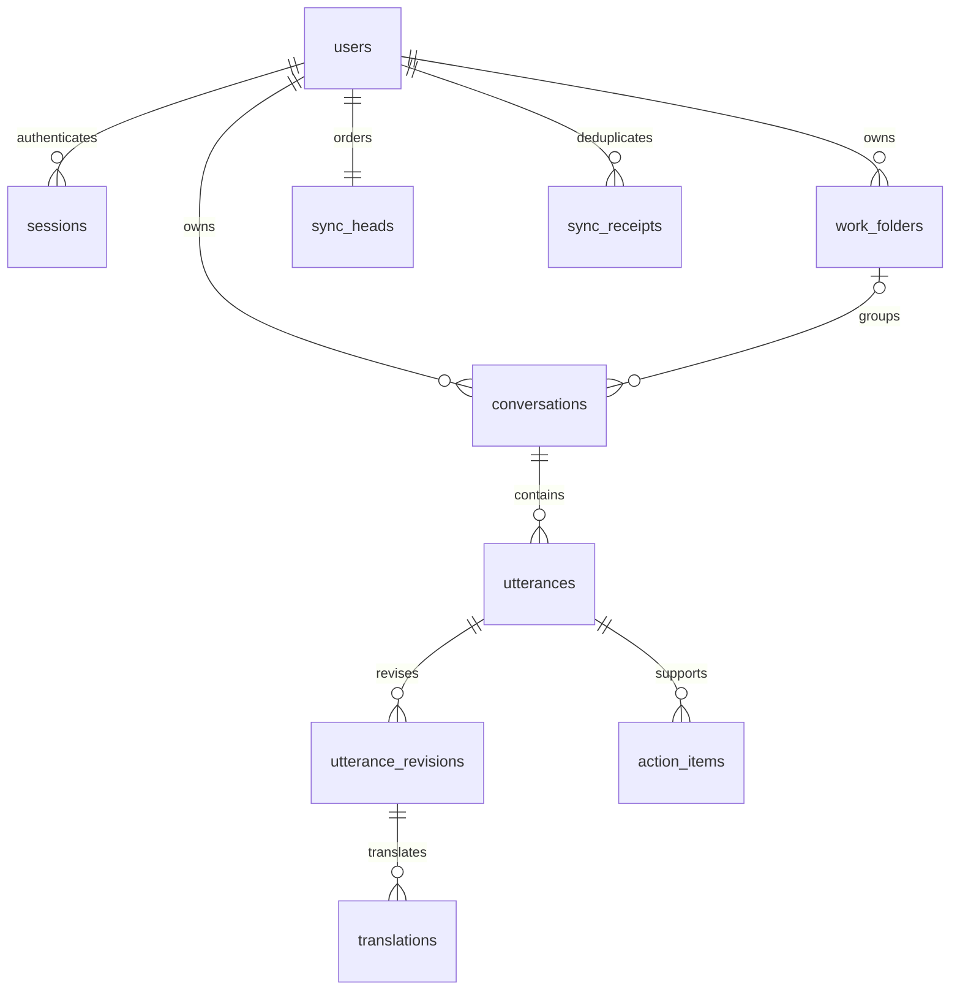

# 프로젝트 전용 PostgreSQL

2026-10-18 서버 구현 기준. 모바일 중앙 저장 연결은 [전체 진행표](../plans/postgres-voice-release.md)를 따른다.

## 실행

프로젝트 루트에서 실행한다. 전역 패키지·설정·다른 DB 서비스를 변경하지 않는다.

```sh
npm --prefix server ci --ignore-scripts --cache .runtime/npm-cache
npm --prefix server run db:install
npm --prefix server run db:init
npm --prefix server run db:import-accounts
npm --prefix server run setup:accounts
npm --prefix server run start:accounts
```

설치 스크립트는 공식 PostgreSQL 18.6 소스와 고정 SHA-256을 사용한다. Xcode 명령줄 빌드 도구가 필요하다. 바이너리·소스·데이터·소켓·비밀번호·로그는 `.runtime/postgres/`에만 생성한다. UTF-8 builtin locale를 사용하고 ICU/readline 의존성은 제외한다. 기존 Homebrew·MariaDB·시스템 서비스는 수정하지 않는다.

`db:init`은 이 클러스터에 `speechbridge`, `speechbridge_test`를 만든다. PostgreSQL은 TCP를 열지 않고 프로젝트 Unix 소켓(권한 0700)만 사용한다. Node API만 DB에 연결한다. `.runtime/postgres/server.env`, `test.env`, `credentials.json`은 공개하지 않는다.

```sh
npm --prefix server run db:status
npm --prefix server run db:start
npm --prefix server run db:migrate
npm --prefix server run db:backup
npm --prefix server run db:stop
npm --prefix server run test:coverage
```

백업은 `.runtime/backups/`에 custom-format dump와 같은 이름의 `.dump.json` 검증 명세를 함께 생성한다. 두 파일은 0600, 폴더는 0700 권한이다. 같은 exported snapshot에서 파일을 만들고 테이블 내용의 SHA-256·행 수·소유권·RLS·정책·권한·제약조건을 기록한다. 사용자 원문과 인증정보를 터미널에 출력하지 않는다. 같은 Mac에 있는 백업은 Mac 자체 고장에 대한 복구 수단은 아니다. 마이그레이션 파일은 적용 후 수정하지 않고 새 번호를 추가한다. 체크섬 변경 시 적용을 거부한다.

## 복원 검증과 복구

앱 루트에서 백업 명령이 출력한 파일 경로를 사용한다. dump와 JSON을 함께 보관한다. JSON이 없는 이전 형식의 백업은 이 검증 도구에서 자동 처리하지 않으며 원본 파일을 보존한다.

```sh
node server/db/backup.mjs verify '.runtime/backups/<백업 파일>.dump'
node server/db/backup.mjs restore '.runtime/backups/<백업 파일>.dump'
```

- `verify`: 파일 체크섬 확인 → 새 `speechbridge_restore_<무작위 ID>` DB에 단일 트랜잭션 복원 → 내용·소유권·접근 정책 비교 → 검증 DB 제거.
- `restore`: 같은 검증 후 복원 DB를 남기고 이름을 반환한다. 기존 운영 DB를 덮어쓰거나 API의 DB 주소를 자동 변경하지 않는다.
- 복원된 DB의 로그인 세션은 검증 후 모두 폐기한다. 원본 DB의 최신 삭제 영수증도 반영하여 삭제된 계정과 기록을 사본에서 제거한다. 나머지 계정·비밀번호 해시·사용자 기록은 유지한다. 원본 삭제 이력을 읽을 수 없으면 복원하지 않는다.
- 손상된 파일, 프로젝트 백업 폴더 밖 파일, 다른 프로젝트 DB 이름, 운영 DB를 삭제 대상으로 지정하는 요청은 거부한다. 실패한 복원은 이번에 생성한 DB만 정리한다.

현재 운영 백업을 실제로 복원해 17개 테이블 비교와 검증 DB 정리를 확인했다. 데이터가 있는 별도 테스트에서는 백업 이후 원본 변경과 복원 사본을 구분하고, RLS 격리·재로그인·기존 토큰 거부를 검사했다. 원자료는 로컬 `.runtime/postgres/backup-validation.json`이며 자격정보와 사용자 내용을 포함한 dump/명세는 Git에 넣지 않는다.

운영 전환은 별도 작업이다. **현재는 `PGDATABASE`만 바꿔 복원 DB를 서비스할 수 없다.** 복원 이후 발생한 삭제 요청이 누락되지 않도록 API 시작 단계에서 복원 DB를 차단한다. 쓰기를 중단하고 마지막 삭제 이력을 반영하는 명시적 전환 절차를 구현해야 한다. [계정 삭제·복원 보호](ACCOUNT_DELETION.md)를 참고한다. 백업·마이그레이션 도구는 프로젝트의 고정 소켓·포트와 기본/복원 DB 이름만 허용한다. 실제 운영 DB 전환은 수행하지 않았다.

## 역할

| 역할 | 접근 범위 |
|---|---|
| speechbridge_admin | 프로젝트 클러스터 초기화·마이그레이션·백업. API에서 사용하지 않음 |
| speechbridge_owner | 로그인 불가, 스키마 소유 |
| speechbridge_auth | 회원·해시 세션·이전 이력 |
| speechbridge_app | 사용자 데이터. 비소유자, superuser/BYPASSRLS 없음 |

복합 키와 외래 키에 `user_id`를 포함한다. RLS는 트랜잭션에만 설정한 인증 사용자 ID를 사용한다. 요청 본문의 사용자 ID로 소유권을 결정하지 않는다. 이는 API 검증을 보완하며 서버 관리자나 서버 전체 침해를 차단한다는 뜻은 아니다.

## 스키마

| 테이블 | 저장 내용 |
|---|---|
| users / sessions | 계정, scrypt hash/salt/파라미터, 해시 토큰·발급 순서·만료 |
| user_settings / devices | 화면 모드, 앱 설치 ID·플랫폼 |
| work_folders | 사용자 지정 업무 폴더·version·삭제 표시 |
| conversations | 제목·요약·언어·일상/업무·업무 유형·폴더·AI 최초 처리 상태·revision |
| utterances / utterance_revisions | 최초/현재 원문, 알려진 수정본·revision·순서 |
| translations | 원문 revision과 번역 대상 언어별 번역 |
| action_items | 발화 근거·내용·담당자/기한 텍스트·검토·완료·입력 순서 |
| conversation_drafts | 사용자+설치+초안 범위별 입력 내용과 언어 |
| ai_jobs | 최초 제목·분류·요약 작업, 입력·revision, 상태·시도 수·다음 실행 시각·실행 소유 토큰과 만료 시각 |
| sync_heads / sync_changes | 사용자별 커밋 순서·변경 엔티티·version·삭제 표시 |
| sync_receipts | 사용자+설치+요청 ID별 요청 해시·응답 |
| legacy_account_imports | 이미 이전한 계정 ID. 폐기된 세션의 재복원 방지 |
| account_deletions | 삭제 계정·아이디·요청 토큰 해시와 시각. 백업/이전 원본을 통한 계정 부활 방지 |
| schema_migrations | 버전·SQL 체크섬·적용 시각 |



정확한 타입·제약·인덱스는 [`server/db/migrations/`](../server/db/migrations/)가 기준이다. 시간은 timestamptz, 기존 ID는 text, revision은 integer, version/cursor는 bigint이다. API의 version/cursor는 JS 정수 손실을 피하도록 문자열이다. JSONB는 초안과 revision 맵 등 부가 정보에 사용한다.

기존 기록에 없는 중간 수정본 원문은 만들어 내지 않는다. 최초/현재 원문과 알려진 revision을 보존한다. `action_items.source_revision`은 이 때문에 수정본 테이블의 FK 대신 발화 FK와 입력 검증을 사용한다. legacy_speaker는 보존 필드이며 화자 판별 기능은 없다.

## 동기화 API

모든 경로에 개인 bearer 세션이 필요하다. 응답은 `Cache-Control: no-store`다.

- `POST /data/snapshot` `{deviceId,platform}` → archive, 해당 설치의 drafts, versions, cursor
- `POST /data/mutate` `{deviceId,platform,mutationId,entity,id,baseVersion,value}` → 저장. value=null이면 삭제. entity는 conversation/folder/settings/draft
- `POST /data/changes` `{after}` → 최대 500개 변경과 다음 cursor

사용자별 카운터 행을 잠근 뒤 변경·영수증·순서를 함께 커밋한다. 같은 요청 ID/내용은 같은 응답을 반환하며 내용이 바뀌면 `mutation_reused`(409)다. 오래된 version은 `version_conflict`(409), 삭제된 엔티티는 늦은 업로드로 복구되지 않는다. 폴더 삭제 시 관련 대화는 보존하고 폴더만 해제하며 version/변경 목록도 함께 갱신한다.

## 계정 이전

기존 API 쓰기를 중지한 상태에서 `db:import-accounts`를 실행한다. SQLite를 읽기 전용으로 열고 일관된 백업을 만든 뒤 그 백업을 가져온다. ID·비밀번호 hash/salt·유효 세션을 유지한다. 충돌하면 전체 트랜잭션을 취소한다. 원본을 삭제하지 않는다. 재실행해도 이미 이전한 계정의 세션을 다시 삽입하지 않는다.

회원 API는 PostgreSQL 설정이 없으면 시작하지 않는다. SQLite로 자동 복귀하지 않는다. 전환 이후의 새 데이터를 보존하지 않고 이전 DB 파일로 단순 복귀하지 않는다.

## 공식 근거

[18.6 소스](https://ftp.postgresql.org/pub/source/v18.6/), [빌드·설치](https://www.postgresql.org/docs/18/install-make.html), [행 보안](https://www.postgresql.org/docs/18/ddl-rowsecurity.html), [백업·복원](https://www.postgresql.org/docs/18/backup-dump.html).

## 모바일 연결

App은 회원 로그인 뒤 HttpSyncRemote와 SyncRepository로 서버 기록을 불러온다. Android의 별도 Keystore AES-GCM 저장소, iOS의 별도 device-only Keychain 항목에 대기 변경만 보관한다. ACK 후 제거하고, 연결 오류는 15초 간격으로 재시도한다. 저장 자체 실패는 완료로 표시하지 않으며 같은 앱 실행 중 계정별 복구 큐를 유지한다. 기기 저장 실패가 해결되기 전에 앱을 강제 종료하면 메모리에만 남은 내용은 복구할 수 없다.

기기의 `platform`은 android/ios/test이며 구버전 요청에서는 생략할 수 있다. 생략된 값이 이미 등록된 Android/iOS 정보를 test로 바꾸지 않는다. 플랫폼 메타데이터는 mutation 내용 해시에서 제외해 구버전 미전송 요청의 재시도가 유지된다.

409 충돌은 자동 덮어쓰지 않는다. 사용자가 ‘모두 보관’을 선택하면 서버 원본과 기기 수정본을 별도 기록으로 보관한다. 삭제 대기 요청은 서버 기록을 남기는 쪽으로 해제한다. 사본을 만들 때 초안과 현재 선택도 사본으로 이동한다. 서로 다른 서버·기기 초안은 각각 보존한다. 다른 기기에서 종료·삭제된 대화에 남은 초안은 새 진행 중 대화로 복구하며, 삭제된 ID를 되살리지 않는다. 서버 재조회는 설정의 새로고침으로 수행하고 초안도 함께 갱신한다. 오프라인 재시작 때 초안만 있고 원래 대화가 기기에 없으면 내용은 보존한 채 서버 재연결을 기다린다.

## 최초 AI 정리와 재시작 복구

진행 중인 대화를 종료하는 저장 트랜잭션에서 `organize` 작업을 함께 생성한다. 이미 종료된 기록을 가져오거나 수동으로 분류한 기록에는 작업을 새로 만들지 않는다. 대화별 고유 제약으로 같은 종료 요청을 재전송해도 작업은 하나다. 앱을 닫거나 로그아웃해도 서버에 저장된 작업은 계속된다. 아직 기기에만 있는 종료 변경은 서버에 전달된 뒤 처리한다.

회원 API의 워커가 계정 ID를 순회하고, 실제 내용은 계정별 RLS 트랜잭션으로만 읽는다. 텍스트·음성 처리와 연산 자원을 공유한다. 작업은 120초 실행 임대와 고유 토큰을 사용하고, 추론은 95초 안에 취소하도록 요청한다. 서버가 갑자기 종료되면 만료된 임대를 재획득한다. 이전 워커의 늦은 결과는 반영하지 않는다. 정상 종료는 작업을 대기로 돌려놓는다.

일시적인 런타임 연결·응답 오류는 같은 작업에서 최대 3회 시도한다(재시도 간격 10초·20초). 잘못된 모델 출력·설정 오류·지나치게 긴 입력은 실패 상태로 남긴다. 원문은 보존하고 사용자가 직접 편집한다. 재생성 버튼은 제공하지 않는다. 작업에 원시 오류나 자격정보를 저장하지 않는다.

완료 시 제목·요약·분류·원문 revision·언어·폴더 목록이 최초 입력과 같은지 다시 확인한다. 변경·삭제됐다면 AI 결과를 버린다. 성공 결과, 대화 version, 동기화 변경 커서는 같은 트랜잭션으로 저장한다. 앱은 작업 대기/실행 중 15초 주기로 결과를 확인한다. 결과를 기다리는 네트워크 요청이 기기의 안전한 저장을 잠그지 않으며, 그사이 새 입력이 생기면 오래된 조회 결과를 적용하지 않는다.

실제 로컬 모델 검증: `node --env-file=.runtime/accounts-server.env server/evaluate-organization-jobs.mjs` (프로젝트 루트). 프로젝트 테스트 DB의 가상 계정만 사용한다. 결과는 [organization-jobs.json](../server/validation/organization-jobs.json). UI 검증과 범위는 [CLOUD_WORKSPACE_VALIDATION.md](CLOUD_WORKSPACE_VALIDATION.md)를 참고한다.

설정의 기존 기록 가져오기는 계정·기록 수를 확인하고 명시적으로 실행한다. 동일 ID의 다른 내용은 거부한다. 서버에서 내용이 일치하는 것을 확인한 후에만 기기 원본을 비우며, 확인 실패 시 원본을 유지한다. 자세한 실행 결과는 [모바일 연결 검증](CLOUD_WORKSPACE_VALIDATION.md)을 참고한다.
