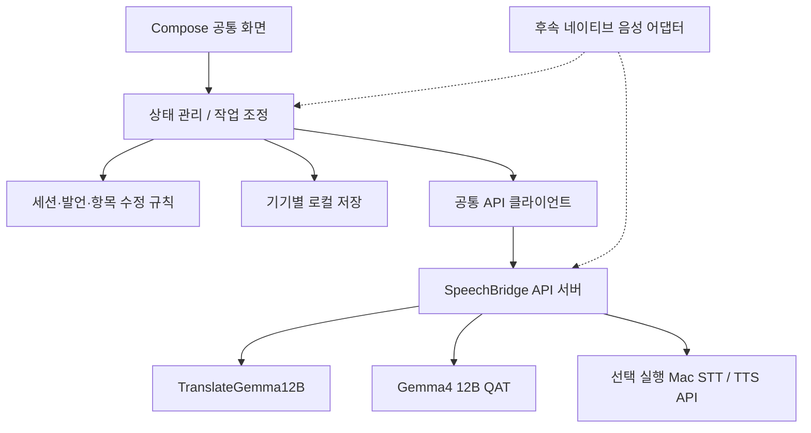

# SpeechBridge 기능 설계

상태: 음성 중심 UI 리디자인·종료 후 자동 제목/분류, 2026-10-17. 최신 검증은 REDESIGN_VALIDATION.md를 따른다. 과거 설계의 독립 번역/기록 선택 정책은 최신 사용자 지시로 대체했다.

## 확정한 목적

수업 과제용 Android/iOS 앱. 한국어·영어·일본어 대화를 번역하고 항상 기록한다. 기록을 확인·수정하고 요청/결정을 할 일로 연결한다. 최신 기기 우선, 구형 기기 지원은 후속. 실기기·음성 성능 검증은 사용자의 요청으로 후속 단계다. 무료 Mac 텍스트 AI 연결은 완료했다. 음성 중심 화면과 자동 감지 준비 UI를 제공하지만 마이크 연결 기능은 추후 구현한다. 키보드는 보조 입력이다.

## 기능 계약

직접 입력·저장·수정·수동 할 일과 무료 Mac 로컬 모델의 번역/AI 정리를 구현했다. 앱 음성 연결과 실기기 검증은 사용자 요청으로 보류한다. 다음은 기능 계약이며 모두의 외부 서비스 검증 완료를 뜻하지 않는다.

- 제목이나 저장 여부를 묻지 않고 시작한다. 수동 언어쌍 선택은 가능하며 음성 자동 감지는 준비 UI만 제공한다.
- 직접 입력한 발언을 추가하고 원문·번역을 확인한다. 후속 STT 최종 이벤트도 같은 발언 추가 경로로 연결할 설계다; 네이티브 연결은 아직 없다.
- 새 대화는 항상 기기에 저장한다. 종료하면 AI가 간결한 제목·일상/업무 분류·대화 요약을 한 번 생성한다. 실패해도 날짜 제목으로 원문은 보존한다.
- 업무 유형은 회의·할 일·아이디어·기타, 사용자 폴더는 별도 축이다. 폴더 생성·이름 변경·삭제 가능. 폴더 삭제는 기록과 할 일을 삭제하지 않는다.
- AI는 원문에 폴더명이 명시된 기존 폴더만 선택한다. 이후 제목·분류·요약은 사용자가 직접 수정한다. AI 재생성은 제공하지 않는다.
- 발언을 수정하고 이전 원문을 확인한다. 오래된 번역·정리 결과는 현재 결과로 표시하지 않는다.
- 발언에 연결된 요청/결정/메모를 직접 만들거나, 연결된 서비스로 정리안을 요청한다. 검토 후 체크박스로 바로 완료하거나 진행 중 할 일로 등록할 수 있다.
- 담당자·기한·내용을 수정하고 검토 완료 후 할 일로 등록/완료한다.
- 기록 삭제는 확인을 거치고 연결된 항목도 함께 삭제한다.
- 개발 빌드에만 서버 URL·접속 토큰을 입력하는 별도 개발자 메뉴를 제공한다. 일반 설정에는 연결 정보를 요구하지 않는다. 배포용 자동 서비스 연결·사용자 인증은 아직 미구현이며 release의 AI 요청은 service_pending으로 종료한다. 현재 서버는 무료 Mac 로컬 모델로 번역/AI 정리를 처리한다. 접속 토큰은 메모리에만 보관한다.
- 키 미설정·연결 실패 시 직접 입력과 기록 기능은 유지하고, 생성하지 못한 번역/정리는 명시한다.
- 실시간 마이크 STT/TTS는 이번 완료 기준에 포함하지 않는다. API/이벤트 계약과 인증 준비를 만들고 실기기 검증 단계에서 네이티브 어댑터를 연결한다. 화면에서 실제 녹음이나 실시간 성능을 제공하는 척하지 않는다.

## 화면 계약

기본 UI는 한국어, 내용 언어는 ko/en/ja. Compose Multiplatform 공통 UI를 사용한다.

| 화면 | 주요 동작 | 빈 상태 / 오류 / 완료 |
| --- | --- | --- |
| 대화 | 음성 중심 화면·언어쌍; 보조 키보드; 종료 후 AI 제목·분류 | 음성 준비 안내, 자동 저장, 제목·분류·요약 실패 시 직접 수정 |
| 기록 | 전체/일상/업무 목록 → 상세; 업무 세부 분류·폴더; 검색 | 기록 없음 안내; 읽기/쓰기 오류와 재시도; 삭제 확인 |
| 할 일 | 검토 대기/진행/완료 항목; 원문 근거 보기; 편집·확정·완료 | 할 일 없음; 원문 변경 시 재검토 표시; 완료 취소 |
| 설정(상단 진입) | 화면 모드 아이콘 전환·업무 폴더 관리·기록 저장 상태 | 모드 선택 영구 저장; 언어 설정은 대화 화면에만 표시 |

시각 방향: DESIGN.md의 블루 계열 디자인 시스템을 따른다. 밝은 블루그레이/흰 표면과 다크 모드의 짙은 네이비 표면, 주요 동작의 블루, 검토의 황색, 오류의 적색. 색상만으로 상태를 전달하지 않는다. 대화는 음성 제어 중심이고 기록·할 일은 내용 중심이다. 실제 렌더링 결과는 docs/DESIGN_REFRESH_VALIDATION.md에 기록한다.

## 데이터와 불변 규칙

- Session: id, title, createdAt, translate, record(신규는항상true), first, second, ended, utterances, items, category?, workType?, folderId?, metadataRevision, organized, organizationAttempted, summary?, organizationSources.
- Archive: version1에 기본값이 있는 folders·appearance 추가. 기존 기록은 미분류로 불러오며 제목/발언/할 일을 보존한다.
- 메타데이터 응답은 원문 revision, metadataRevision, 폴더 목록 snapshot이 일치할 때만 적용한다.
- Utterance: id, speaker(기존 데이터 호환용; 신규 UI 입력은 빈 값이며 화자 표시·추론 없음), language, originalText, text, revision, translation, translationRevision. 필드의 실제 정의는 Conversation.kt를 기준으로 한다.
- Item: id, sourceUtteranceId, sourceRevision, kind(request/decision/note), text, owner?, dueText?, reviewed, status(candidate/todo/done), origin(manual/service).
- 음성 기반 기록도 같은 Utterance 모델로 연결한다. 임시 STT 결과는 별도 화면 상태이며 영구 저장하지 않는다.
- revision은 수정할 때 증가한다. 번역은 해당 revision과 일치할 때만 현재 결과다.
- 원문 수정은 연결 항목의 reviewed를 해제하고 완료 상태라면 다시 검토할 수 있도록 표시한다. 사용자가 쓴 내용을 자동으로 덮어쓰지 않는다.
- 항목의 내용·담당자·기한을 편집하면 reviewed를 해제한다. sourceRevision은 근거를 보고 별도로 검토 완료할 때만 최신화한다. 재검토 중인 완료 항목도 검토 대기 목록에 나타낸다.
- 사람이 검토한 항목도 참석자 전원의 합의라고 표시하지 않는다.
- 담당자/기한을 모델이 추측해 확정하지 않는다. 명시되지 않으면 null. 상대 날짜는 원문 표현을 보존한다.
- 자동 추출은 새 초안이다. 검토 완료나 할 일 등록을 자동 실행하지 않는다.
- 정리 요청은 근거 발언 ID와 버전을 포함한다. 존재하지 않는 근거, 빈 내용, 잘못된 종류는 거부한다.
- 네트워크 응답은 session/utterance/revision이 아직 유효할 때만 반영한다. 단조 증가 요청 ID와 요청 취소/무효화, 세션 존재 및 근거 revision을 함께 검사한다. 종료는 그 전에 시작한 요청을 취소하지만, 종료된 기록에서 새로 시작한 재번역/할 일 추출은 허용한다. 제목·분류·요약은 최초 종료 시 한 번만 요청한다. 삭제·수정 전의 오래된 결과는 무시한다.
- 신규 대화는 항상 저장한다. legacy record=false 데이터 처리만 저장 코덱에 호환용으로 남겨 두었다. 요청 본문/음성/키는 서버 로그에 남기지 않는다.
- 녹음 파일은 저장하지 않는다. 따라서 다시 듣기 기능을 표시하지 않는다.

## 저장과 연결 복구

- 저장 포맷 버전을 검사한다. 읽기 실패·손상·알 수 없는 버전이면 파일을 보존하고 쓰기를 잠근다. 자동으로 빈 기록을 덮어쓰지 않는다. 다시 읽기를 제공한다.
- 저장은 순차 처리하고 임시 파일/원자적 교체를 사용한다. 실패 시 메모리 변경은 유지하되 미저장 표시와 재시도를 제공한다.
- 서버 키용 .env와 백업은 .gitignore에 포함한다. 앱 접속 토큰은 영구 저장하지 않는다.
- Android INTERNET 권한을 추가한다. 개발 HTTP는 localhost/127.0.0.1/10.0.2.2만 허용한다. 일반 호스트는 HTTPS만 허용하고 리다이렉트를 따르지 않는다.
- Android 에뮬레이터는 adb reverse 후 localhost를 기본 경로로 사용한다(에뮬레이터 대안 10.0.2.2). iOS 시뮬레이터는 localhost로 개발 서버에 접근한다. iOS ATS는 로컬 개발 예외만 적용한다. 실제 기기 연결은 후속 검증 대상이다.

## 구조

공통 코드: 도메인 규칙, 상태, JSON, HTTP 요청 계약, Compose 화면. 플랫폼 코드: 앱 시작, 로컬 저장, 후속 마이크·오디오 어댑터. SDK를 공통 코드에 직접 끌어들이지 않는다.

## AI 선정 — 무료 로컬 텍스트 실측 완료

유료 API를 사용하지 않는다. 기존 Azure/OpenAI 외부 호출 코드는 제거했다. 현재 Mac M3 Max36GB를 서버로 사용하고 공개 모델 및 정식 무료 API를 비교한다. 우선 후보와 공식 근거는 [FREE_AI_RESEARCH.md](FREE_AI_RESEARCH.md)에 있다.

Node API 서버는 기존 인증·입력·응답 계약을 유지한다. 무료 로컬 provider를 연결해 다른 언어 번역/추출을 처리한다. 음성 API는 별도 선택 실행이며 이번 텍스트 작업에서 사용하지 않는다. 같은 언어 번역은 원문을 돌려준다. 실제 활성 상태와 실행 절차는 [API_SETUP.md](API_SETUP.md)를 따른다.

## API 계약

모든 POST 경로는 `Authorization: Bearer <APP_ACCESS_TOKEN>` 필요. 토큰은 최소 길이를 검증하고 서버에서 비교한다. 개발 서버 기본 바인딩은 127.0.0.1. 외부 접근 시 HTTPS 및 사용자별 인증이 선행되어야 한다.

- GET /health → 서비스 준비 여부. 키·지역 세부정보·본문 미노출.
- POST /translate: {text, from, to, revision} → {text, revision}. ko/en/ja, 동일 언어는 서비스 호출 없이 반환.
- POST /extract: {utterances:[{id,revision,text}], language} → {items:[{sourceUtteranceId,sourceRevision,kind,text,owner,dueText}]}. 정리 언어와 원문 언어를 구별한다.
- POST /organize: {utterances:[{id,revision,text}], language, folders:[{id,name}]} → {title, summary, category:DAILY|WORK, workType:MEETING|TASK|IDEA|OTHER|null, folderId:null|string}. 동일 로컬 모델·인증·취소·텍스트 큐 사용.
- 음성 경로의 현재 계약은 API_SETUP.md와 plans/voice-pipeline.md를 따른다. 앱 연결은 보류 중이다.
- 오류는 {error:{code,message}}로 반환한다. disabled provider는503 free_provider_pending, 로컬 모델 미설치/런타임 종료/context 초과/timeout/잘못된 결과는 각각 구분한 오류다. 상세 상태 코드는 실제 서버 구현을 따른다.
- 서버는 입력 크기, 발언 수, 동시 호출을 제한하고 timeout을 둔다. 무제한 재시도나 자동 폴링을 하지 않는다. 이는 부하·메모리 보호를 위한 운영 설정이며 제품 사용 범위 제한이 아니다.
- 외부 요청에는 실제 사용자 입력만 데이터로 보내고 발언 안의 명령을 시스템 지시로 처리하지 않는다. 모델에 도구 실행 권한을 주지 않는다.

## 검증

- 공통 테스트: 신규 대화 항상 저장, 기존 기록/폴더 호환, 자동 메타데이터와 늦은 응답 거부, 폴더 삭제 시 기록 유지, 수정 후 번역/항목 무효화, 오래된 응답 무시, 근거 연결, 검토 전 완료 방지, 삭제·직렬화 복원.
- 서버 테스트: 인증·입력 검사, disabled 경로, 유료 키 차단, 로컬 모델 확인, 잘못된 근거/인용문, 문맥 초과, 요청 취소/timeout, 동시 호출·빈도 제한.
- Android: `./gradlew :shared:testAndroidHostTest :androidApp:assembleDebug`.
- iOS: `./gradlew :shared:compileKotlinIosSimulatorArm64` 및 가능한 시뮬레이터 빌드.
- 텍스트 API 실측과 시뮬레이터 UI는 NONVOICE_VALIDATION.md에 기록했다. 실기기·마이크 성능은 미검증. 합성 샘플 결과를 일반 정확도로 표현하지 않는다.

## 미확정 / 인계

이번 상태는 실제 텍스트 기능이 동작하는 사용성 개선 시제품이다. 기록 검색, 할 일 필터, 초안 보존, 항목별 오류·재시도, 확인 대화상자, 적응형 탐색을 제공한다. 시각·행동 기준은 DESIGN.md/UX-CONTRACT.md, 실행 증거와 제한은 [NONVOICE_VALIDATION](NONVOICE_VALIDATION.md)을 따른다. 음성 연결·실기기·LAN HTTPS·외부 배포는 보류한다. 모델 출력의 의미 오류 가능성과 실제 사용자 접근성 평가는 남아 있다.

## 설계 검토 후 확정한 세부 규칙

- R4: 모든 새 대화는 저장한다. 초안과 접속 토큰은 영구 저장하지 않는다. 종료 시 작성 중 문장을 포함하도록 안내한다. 언어쌍 변경 시 기존 번역을 무효화한다. 음성 입력은 준비 UI이며 실제 녹음이 아니다.
- R5: 서버 APP_ACCESS_TOKEN이 없거나 짧으면 POST 경로를 차단한다. 앱·서버 모두 redirect를 따르지 않는다. Android debug만 루프백 HTTP를 허용하고 adb reverse를 안내한다. iOS는 로컬 네트워크 예외만 둔다.
- R6: health 응답의 configured는 설정 상태다. 로컬 provider의 번역/추출 설정은 true, 음성은 선택한 provider 설정을 따른다. available은 설치된 모델, runtime은 런타임 상태를 별도로 나타낸다. 실제 번역/추출 성공과 구분해 표시한다.
- R8: Android 앱 전용 noBackupFilesDir에 저장하고 allowBackup=false로 설정한다. iOS Application Support 하위 파일은 NSURLIsExcludedFromBackupKey로 백업에서 제외한다. 서버는 모든 응답에 Cache-Control: no-store를 적용한다.

## AI 실행 위치 결정 (사용자 추가 지시)

AI 추론·학습 부담은 서버가 맡는다. 사용자 기기에 LLM을 다운로드/실행하지 않는다. 현재 Mac에서 무료 공개 모델을 우선 검증하고 정식 무료 API와 비교한다. 유료 경로는 사용하지 않는다. 세부 평가 기준은 AI_STRATEGY.md, 연결 절차는 API_SETUP.md를 따른다.

## 무료 로컬 연결 후 근거 상태 보완

AI 항목은 정확한 원문 인용문(evidenceQuote)과 전체 대화의 ID/revision snapshot(contextRevisions)을 보관한다. 후속 발언 추가·수정도 취소/정정일 수 있으므로 기존 AI 항목을 재검토로 전환한다. 새 정리에서 빠진 항목은 omittedByLatestExtraction으로 표시하고 자동 삭제하거나 기존 사용자 편집을 덮어쓰지 않는다. 변경된 대화 전체와 제외 경고를 보여 주고 사용자가 유지할 항목만 다시 확인한다. UI와 서버의 인용문 검사는 의미 정확도를 보장하지 않는다. 저장 형식의 추가 필드는 기본값을 두어 기존 기록을 읽을 수 있다.
